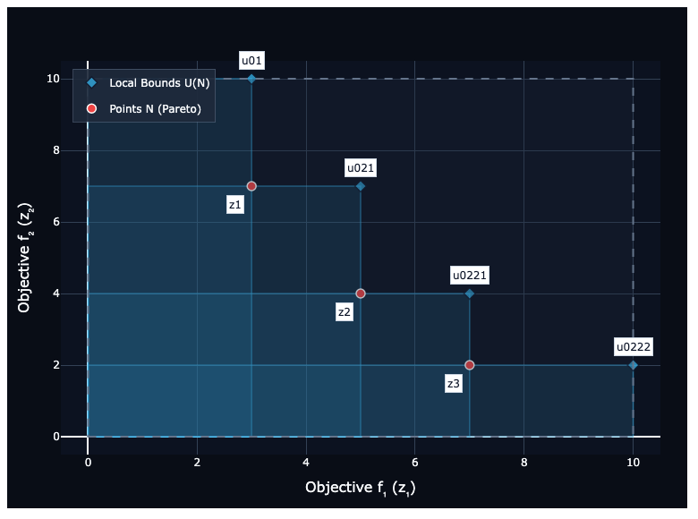

# Local-Bounds-MO Library

[](https://github.com/gaplopes/local-bounds-mo/actions/workflows/ci.yml)
[](https://opensource.org/licenses/MIT)
[](https://isocpp.org/)
[](https://cmake.org/)
[](#installation)
[](https://www.python.org/)

> Header-only C++ library, with Python bindings, that maintains the local upper/lower bounds of the search region in multiobjective optimization.

While a multiobjective optimizer runs, it holds a set of points that do not
dominate one another. The **search region** is the part of the objective space
where a new nondominated point can still be. It is a union of boxes, and each
box is described by one corner: a **local upper bound** (a local lower bound
when maximizing). This library keeps that set of corners up to date as points
are added.



*Minimization in two objectives. Three points (red) give four local upper
bounds (blue). A new nondominated point can only lie inside one of the boxes.*

The library is an independent implementation of the algorithms in two papers,
which do not come with source code:

- **Paper 1:** Klamroth, Lacour and Vanderpooten, *On the representation of the search region in multi-objective optimization*, EJOR, 2015. [DOI: 10.1016/j.ejor.2015.03.031](http://dx.doi.org/10.1016/j.ejor.2015.03.031)
- **Paper 2:** Dächert, Klamroth, Lacour and Vanderpooten, *Efficient computation of the search region in multi-objective optimization*, EJOR, 2017. [DOI: 10.1016/j.ejor.2016.05.029](http://dx.doi.org/10.1016/j.ejor.2016.05.029)

## Contents

- [Installation](#installation)
- [Quick start](#quick-start)
- [Reference points and valid input](#reference-points-and-valid-input)
- [Choosing a class and a method](#choosing-a-class-and-a-method)
- [API](#api)
- [Dashboard](#dashboard)
- [Tests and benchmarks](#tests-and-benchmarks)
- [Repository layout](#repository-layout)
- [Citation](#citation)

## Installation

### C++

Requires C++17. The library is header-only, so any of these works.

**CMake FetchContent**

```cmake
include(FetchContent)
FetchContent_Declare(
    local_bounds
    GIT_REPOSITORY https://github.com/gaplopes/local-bounds-mo.git
    GIT_TAG        main   # pin a commit hash for reproducible builds
)
FetchContent_MakeAvailable(local_bounds)

target_link_libraries(your_target PRIVATE local_bounds)
```

**Subdirectory or submodule**

```cmake
add_subdirectory(external/local-bounds-mo)
target_link_libraries(your_target PRIVATE local_bounds)
```

**System-wide install**

```bash
cmake -B build -DBUILD_TESTS=OFF -DBUILD_EXAMPLES=OFF -DBUILD_BENCHMARK=OFF
cmake --install build --prefix /usr/local
```

```cmake
find_package(local_bounds REQUIRED)
target_link_libraries(your_target PRIVATE local_bounds::local_bounds)
```

**No CMake:** copy the `include/` directory into your project and add it to the include path.

CMake 3.15 or newer is needed; 3.21 for the presets in [CMakePresets.json](CMakePresets.json).

### Python

Requires Python 3.8+, a C++17 compiler and CMake. The package is built from source.

```bash
pip install "git+https://github.com/gaplopes/local-bounds-mo"
```

From a checkout, `pip install .` installs the library and `pip install ".[vis]"` adds the dependencies of the [dashboard](#dashboard). Use `pip install -e .` while developing, and run it again after changing C++ code.

## Quick start

### C++

```cpp
#include <iostream>
#include "local_bounds.hpp"
using namespace local_bounds;

int main() {
    // Minimization in the box [0, 100)^3.
    BoundSet<double, Objective::MINIMIZE> bounds(
        {100.0, 100.0, 100.0},  // reference: strictly worse than every point
        {  0.0,   0.0,   0.0}   // anti-reference: at least as good as every point
    );

    auto [updated, replaced] = bounds.update_auto(Point<double>("z1", {30.0, 70.0, 50.0}));
    if (updated) std::cout << replaced.size() << " bound(s) replaced\n";
    bounds.update_auto(Point<double>("z2", {50.0, 50.0, 40.0}));

    for (const auto& b : bounds.bounds())
        std::cout << b.to_string() << "\n";

    // Could (40, 60, 45) still be a nondominated point?
    std::cout << std::boolalpha << bounds.is_in_search_region({40.0, 60.0, 45.0}) << "\n";
}
```

`NeighborhoodBoundSet` also knows which bounds are neighbors:

```cpp
NeighborhoodBoundSet<double, Objective::MINIMIZE> nbs({100.0, 100.0, 100.0}, {0.0, 0.0, 0.0});
nbs.update(Point<double>("z1", {30.0, 70.0, 50.0}));
nbs.update(Point<double>("z2", {50.0, 50.0, 40.0}));

for (const auto& b : nbs.nonredundant_bounds())
    std::cout << b.to_string() << "\n";

auto graph = nbs.get_adjacency_graph();  // graph.nodes[i] is adjacent to graph.adjacency_list[i]
```

### Python

```python
from local_bounds import BoundSet, NeighborhoodBoundSet, Objective, Point

bounds = BoundSet([100.0, 100.0, 100.0], [0.0, 0.0, 0.0], sense=Objective.MINIMIZE)
updated, replaced = bounds.update_auto(Point("z1", [30.0, 70.0, 50.0]))
bounds.update_auto(Point("z2", [50.0, 50.0, 40.0]))

for b in bounds.bounds():
    print(b)
print(bounds.is_in_search_region([40.0, 60.0, 45.0]))

nbs = NeighborhoodBoundSet([100.0] * 3, [0.0] * 3)
nbs.update(Point("z1", [30.0, 70.0, 50.0]))
graph = nbs.get_adjacency_graph()
print(len(graph.nodes), graph.adjacency_list)
```

## Reference points and valid input

Every bound set works inside a box given by two corners.

| | `MINIMIZE` | `MAXIMIZE` |
|---|---|---|
| `reference_point` | upper corner: strictly greater than every point | lower corner: strictly less than every point |
| `anti_reference` | lower corner: less than or equal to every point | upper corner: greater than or equal to every point |
| Accepted points `z` | `anti <= z < reference` | `reference < z <= anti` |

- **Do not pass the nadir point as the reference.** A point that reaches the
  nadir in some objective would lie on the excluded boundary and be rejected.
  Use a corner that is strictly worse, for example nadir + 1 for integer data.
- `update_ra()` and `update_ra_sa()` are stricter: they also need `z` to differ
  from the anti-reference in every objective.
- Coordinates must be finite and have the right dimension. Otherwise the call
  throws `std::invalid_argument` (`ValueError` in Python) and changes nothing.
- The algorithms assume that the inserted points do not dominate one another.
  A point that lies in no search zone, such as a dominated or repeated point,
  is ignored and the update returns `{false, {}}`.
- Queries outside the box return `false` or no bound.

Two terms from the papers are used below. Points are in **general position**
when no two of them share a value in any objective. Otherwise they have
**ties**.

## Choosing a class and a method

Not sure? Create a `BoundSet` with both corners and call `update_auto()`. It
uses `update_re()` for up to five objectives and `update_ra()` from six, the
split Paper 1 found in its experiments.

| You need | Use |
|---|---|
| The bounds, nothing else | `BoundSet::update_auto()` |
| The bounds for many points in few objectives | `BoundSetTree::update_re()`, which replaces the linear scan by a spatial index |
| To know which bounds are neighbors | `NeighborhoodBoundSet::update()` |
| The points that define each bound, in general position | `BoundSet::update_ra_sa()` |
| The points that define each bound, with ties | `BoundSet::update_ra()` |
| A slow reference to check results against | `BoundSet::update_naive()` |
| To work with only the reference corner | `BoundSet(reference)` with `update_re()`, or `BoundSetTree(reference)` |

| Method | Source |
|---|---|
| `BoundSet::update_re()`, `update_re_enhanced()` | Paper 1, redundancy elimination (Algorithm 3) |
| `BoundSet::update_ra_sa()` | Paper 1, Algorithm 4: redundancy avoidance, general position only |
| `BoundSet::update_ra()` | Paper 1, Algorithm 5: redundancy avoidance, ties allowed |
| `NeighborhoodBoundSet::update()` | Paper 2, Algorithm 1 |

Things to know:

- **Speed depends on the instance.** The number of bounds replaced by one
  point grows quickly with the number of objectives. [benchmark/](benchmark/README.md)
  measures every method; run it on inputs like yours when speed matters.
- **Stay with one method per `BoundSet`.** `update_ra()` and `update_ra_sa()`
  need a `BoundSet` built with both corners that has only been updated by that
  same method. Otherwise they throw `std::logic_error`. `update_auto()` falls
  back to `update_re()` in that situation.
- **`update_re()` and `update_re_enhanced()` return the same bounds.** On
  `BoundSetTree`, `update_auto()`, `update_re_enhanced()` and `update_naive()`
  are other names for its `update_re()`.
- **With ties, `NeighborhoodBoundSet` keeps extra bounds.** These
  *quasi-nonredundant* bounds hold the neighborhood graph together. `bounds()`
  and `size()` include them; `nonredundant_bounds()` and `nonredundant_size()`
  leave them out and match what `BoundSet` returns. In general position there
  are none.

## API

All classes are templates `Class<T = double, Sense = Objective::MINIMIZE>` in
namespace `local_bounds`. Include `local_bounds.hpp`.

| | `BoundSet` | `BoundSetTree` | `NeighborhoodBoundSet` |
|---|---|---|---|
| Construct from | `(reference)` or `(reference, anti)` | `(reference)` or `(reference, anti)`, then optional `max_leaf_size = 32`, `num_children = 8` | `(reference, anti)` |
| Update with a `Point<T>` | `update_auto`, `update_re`, `update_re_enhanced`, `update_ra_sa`, `update_ra`, `update_naive` | `update_re` and its other names | `update` |
| `bounds()` | yes | yes | yes, with quasi-nonredundant bounds |
| `nonredundant_bounds()`, `nonredundant_size()` | | | yes |
| `size()`, `dimensions()` | yes | yes | yes |
| `is_in_search_region(coordinates)` | yes | yes | yes |
| `find_containing_bound(coordinates)` | yes | yes | yes |
| `get_adjacency_graph(include_quasi = false)` | | | yes |

**Points and bounds.** `Point<T>` has an `id` and `coordinates`. `LocalBound<T>`
has an `id`, `coordinates`, and two fields that only some methods fill:

- `defining_points`: one point per component that fixes that coordinate of the
  bound. Filled by `update_ra_sa()` and by `NeighborhoodBoundSet`. With ties,
  `NeighborhoodBoundSet` breaks them by insertion order as in Paper 2,
  Section 4.3.
- `defining_point_sets`: all such points per component. Filled by `update_ra()`.

**Update result.** Every update returns `UpdateResult<T>`, a
`std::pair<bool, std::vector<LocalBound<T>>>`. The flag tells whether anything
changed. The vector holds copies of the bounds the new point replaced, in no
particular order, and is empty exactly when the flag is false.

**Queries.** `is_in_search_region` tells whether a new nondominated point could
have these coordinates. `find_containing_bound` returns one bound whose search
zone contains them, as a `std::optional`.

**Adjacency graph.** `get_adjacency_graph()` returns `nodes`, `adjacency_list`
(indices into `nodes`), `k_neighbors` (for each node, its neighbor in each
component, or `NeighborhoodBoundSet::npos`) and `quasi` flags. By default
quasi-nonredundant bounds are contracted away; pass `true` to keep them.

**Dominance helpers.** `weakly_dominates`, `strictly_dominates`, `dominates`
and `incomparable` compare two coordinate vectors for a given sense.

**Python.** The names are the same, with these differences:

- `BoundSet(...)`, `BoundSetTree(...)` and `NeighborhoodBoundSet(...)` take
  `sense=Objective.MINIMIZE` or `Objective.MAXIMIZE` instead of a template
  argument. They are functions that return an object of a sense-specific class,
  so they cannot be used with `isinstance`. Each object has a `sense` attribute.
- Coordinates are `float`. Updates return an `(updated, replaced)` tuple, and
  `find_containing_bound` returns a `LocalBound` or `None`. Unpack the tuple
  before testing it: `(False, [])` is itself truthy.
- Invalid input raises `ValueError`; a method that the bound set cannot run
  raises `RuntimeError`.
- In `k_neighbors`, a missing neighbor is the integer `2**64 - 1`.

## Dashboard

`local_bounds.visualization` shows local bounds in two or three objectives: an
interactive dashboard, standalone HTML reports and a plotting API, with presets
that reproduce examples from both papers.

```bash
pip install ".[vis]"
python -m local_bounds.visualization.app --port 8050
```

See the [visualization guide](visualization/README.md).

## Tests and benchmarks

```bash
# C++
cmake -B build
cmake --build build
ctest --test-dir build

# Python bindings and dashboard
pip install ".[vis,test]"
python -m pytest tests
```

The C++ tests cover the dominance helpers, `BoundSet`, and
`NeighborhoodBoundSet`, including worked examples from both papers and random
inputs with ties for both senses. The Python tests cover the bindings,
`BoundSetTree` and the dashboard.

[benchmark/](benchmark/README.md) compares all update methods on random
instances like those of the papers and checks that they agree.

## Repository layout

| Path | Contents |
|---|---|
| `include/local_bounds.hpp` | The one header to include |
| `include/local_bounds/` | `BoundSet`, `BoundSetTree`, `NeighborhoodBoundSet`, points, bounds and dominance helpers |
| `include/structures/` | `LBTree`, the spatial index behind `BoundSetTree` |
| `python/` | nanobind bindings and the `local_bounds` Python package |
| `visualization/` | Dashboard, report CLI and plotting, installed as `local_bounds.visualization` |
| `examples/` | A small C++ program for both senses |
| `tests/` | C++ and Python tests |
| `benchmark/` | Algorithm comparison and tree diagnostics |
| `docs/design.md` | Costs of each update and implementation notes |

## Contributing

Bug reports, fixes and improvements are welcome. For larger changes, please
open an issue first to discuss the approach.

## Citation

If you use this library in your research, please cite the two papers and this
implementation:

```bibtex
@article{klamroth2015,
  author  = {Klamroth, Kathrin and Lacour, Renaud and Vanderpooten, Daniel},
  title   = {On the representation of the search region in multi-objective optimization},
  journal = {European Journal of Operational Research},
  volume  = {245},
  pages   = {767--778},
  year    = {2015},
  doi     = {10.1016/j.ejor.2015.03.031}
}

@article{dachert2017,
  author  = {D{\"a}chert, Kerstin and Klamroth, Kathrin and Lacour, Renaud and Vanderpooten, Daniel},
  title   = {Efficient computation of the search region in multi-objective optimization},
  journal = {European Journal of Operational Research},
  year    = {2017},
  doi     = {10.1016/j.ejor.2016.05.029}
}

@software{localboundsmo,
  author       = {Lopes, Gon{\c{c}}alo},
  title        = {{Local Bounds Library}: C++ header-only implementation of
                  local bounds algorithms for multiobjective optimization},
  year         = {2026},
  url          = {https://github.com/gaplopes/local-bounds-mo}
}
```

## License

This project is licensed under the MIT License - see the [LICENSE](LICENSE) file for details.

## Contact

For questions or issues, please open an issue on the repository or contact the author at galopes@dei.uc.pt.
